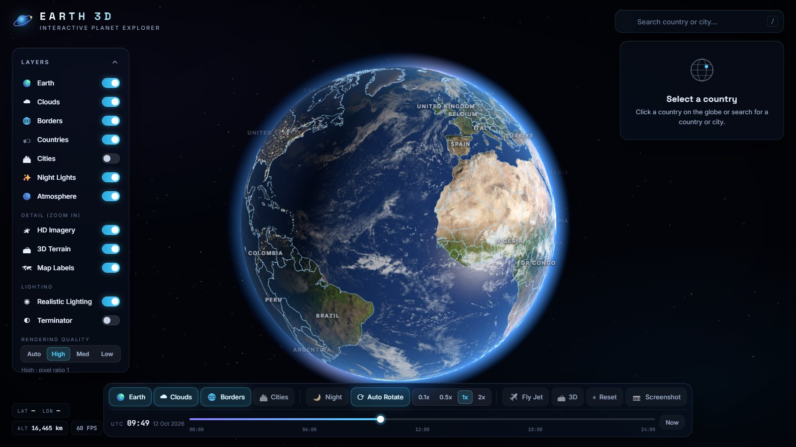
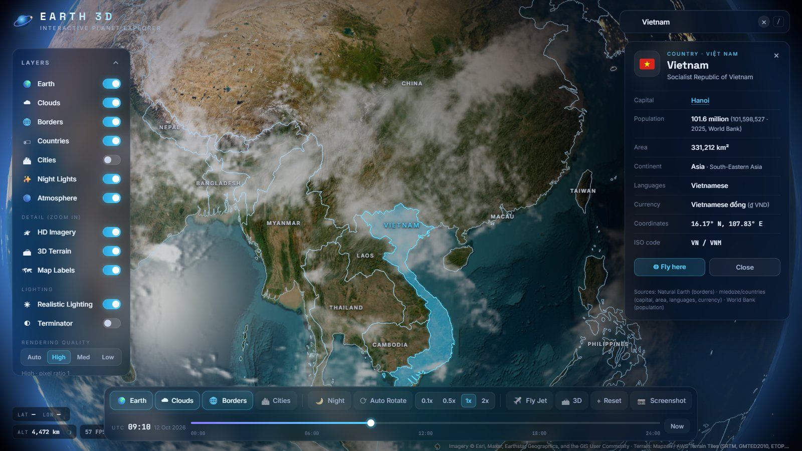
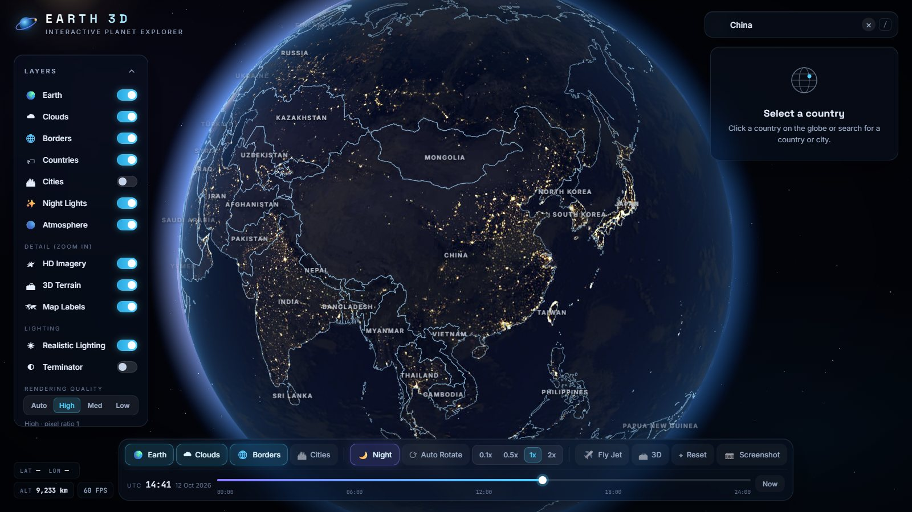
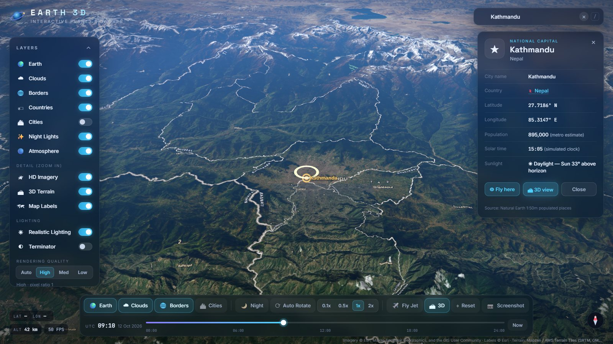
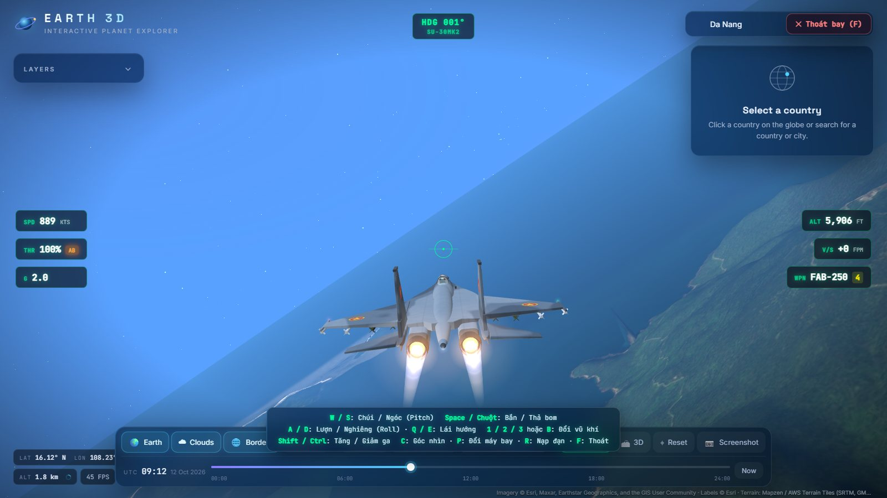
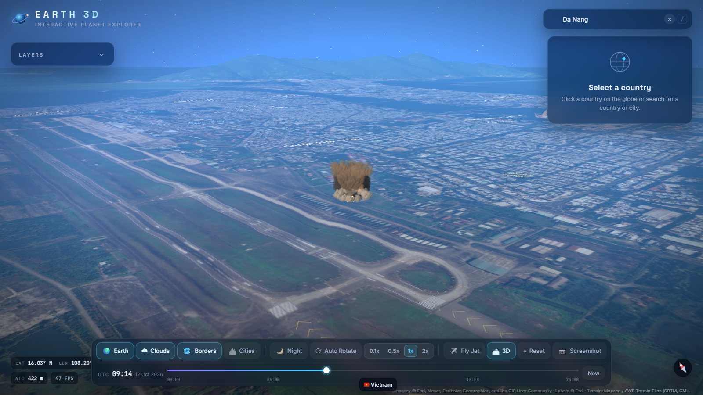
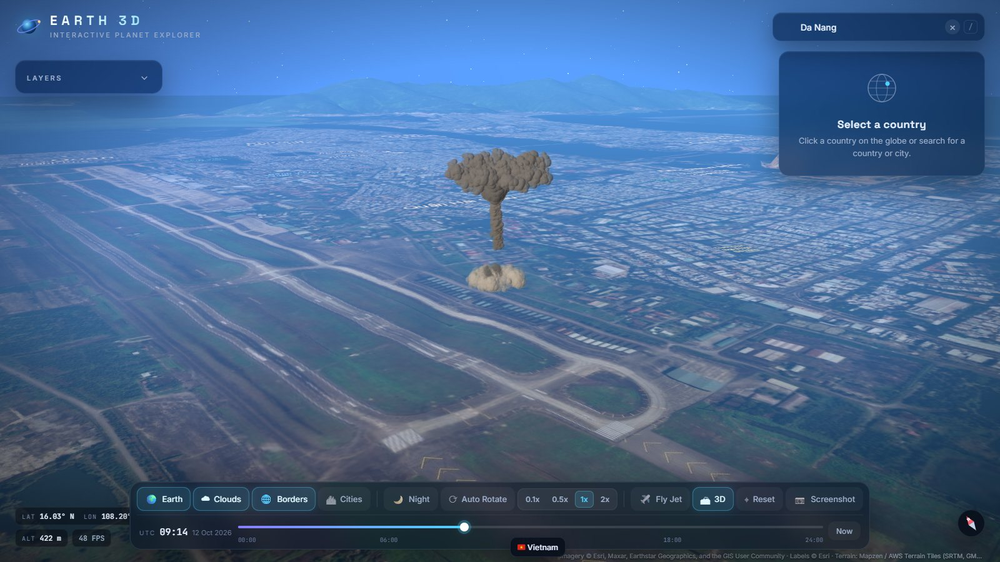
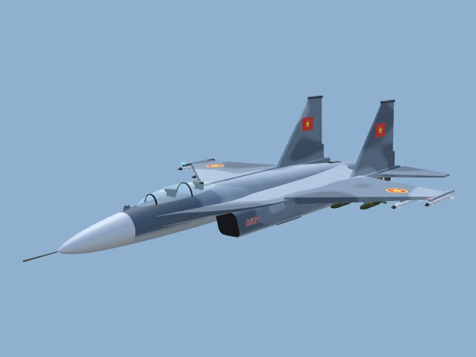
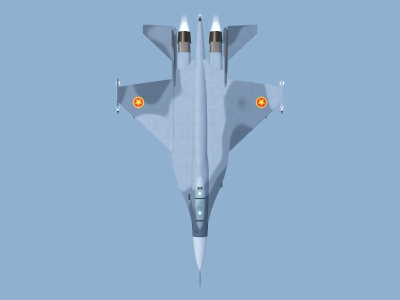
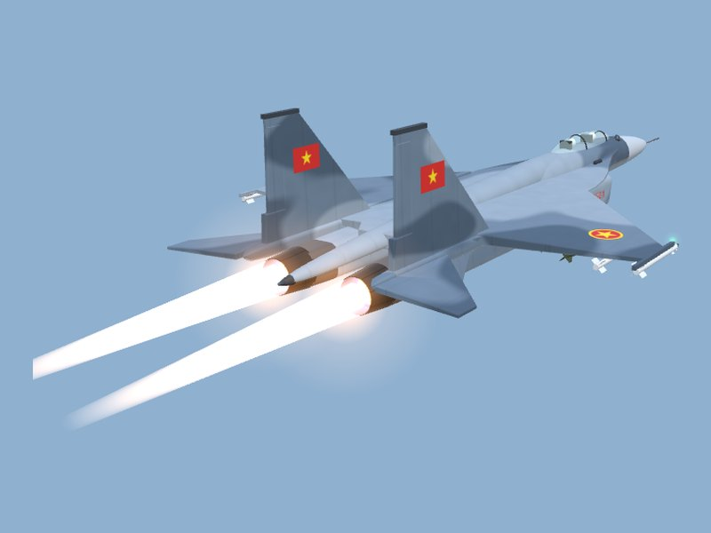

<div align="center">

# 🌍 Earth 3D — Trái Đất 3D tương tác

**Khám phá Trái Đất từ ngoài không gian xuống tận mái nhà, rồi cất cánh với tiêm kích Su-30MK2 ngay trên địa hình thật.**




</div>

Earth 3D là ứng dụng web mô phỏng Trái Đất 3D chạy trực tiếp trên trình duyệt: **three.js + WebGL 2, JavaScript thuần, không framework, không bước build**. Ứng dụng kết hợp dữ liệu địa lý thật (Natural Earth, World Bank), ảnh vệ tinh độ phân giải cao và độ cao địa hình 3D, cùng một **chế độ bay chiến đấu**: điều khiển Su-30MK2 hoặc F-16, bắn pháo, phóng tên lửa và thả bom với hiệu ứng nổ, khói và âm thanh được tạo hoàn toàn bằng code.

## Mục lục

- [Tính năng chính](#-tính-năng-chính)
- [Hình ảnh](#-hình-ảnh)
- [Bắt đầu nhanh](#-bắt-đầu-nhanh)
- [Điều khiển](#-điều-khiển)
- [Chế độ bay](#%EF%B8%8F-chế-độ-bay)
- [Kiến trúc & cấu trúc thư mục](#-kiến-trúc--cấu-trúc-thư-mục)
- [Zoom sâu: ảnh vệ tinh, nhãn bản đồ & địa hình 3D](#%EF%B8%8F-zoom-sâu-ảnh-vệ-tinh-nhãn-bản-đồ--địa-hình-3d)
- [Tùy biến](#-tùy-biến)
- [Triển khai](#-triển-khai)
- [Hiệu năng & độ bền](#-hiệu-năng--độ-bền)
- [Giới hạn hiện tại](#-giới-hạn-hiện-tại)
- [Nguồn dữ liệu & giấy phép](#-nguồn-dữ-liệu--giấy-phép)

---

## ✨ Tính năng chính

### 🌐 Quả địa cầu chân thực
- Sphere 3D với **shader tự viết**: texture ngày 4K, normal map địa hình, phản chiếu nắng trên đại dương, mây đổ bóng, khí quyển phát sáng ở viền và chuyển thành bầu trời xanh khi xuống thấp.
- **Ánh sáng Mặt Trời theo giờ UTC thật** (xích vĩ + phương trình thời gian của NOAA), đường phân chia ngày/đêm, đèn thành phố ban đêm, thanh thời gian 00:00–24:00.
- Bầu trời hàng nghìn ngôi sao có dải Ngân Hà, chỉ tốn một draw call.

### 🛰 Zoom sâu kiểu Google Earth
- Từ không gian xuống còn **~640 m** trên mặt đất, zoom về phía con trỏ, kéo "nắm" mặt đất, nghiêng tới 80° và xoay hướng nhìn.
- **Ảnh vệ tinh tới zoom 18** (~0,6 m/pixel), **địa hình 3D từ dữ liệu độ cao thật**, **nhãn địa danh tiếng Việt**: tải theo vùng đang xem và chuyển mờ dần, không lỗ trống.
- Mất mạng thì tự quay về texture có sẵn, không lỗi.

### 🗺 Dữ liệu địa lý thật
- **240 quốc gia/vùng lãnh thổ** (biên giới Natural Earth 1:50m) và **1.251 thành phố**, tô sáng khi rê chuột, panel thông tin đầy đủ: thủ đô, dân số World Bank 2025, diện tích, ngôn ngữ, tiền tệ, giờ mặt trời.
- Tìm kiếm tức thì, **không phân biệt dấu** ("Viet Nam", "Việt Nam", "vietnam" đều ra Vietnam). Camera bay theo cung tròn lớn.

### ✈️ Chế độ bay & chiến đấu
- **Su-30MK2** (mặc định) và **F-16C** được dựng hoàn toàn bằng code: cánh lái chuyển động, lửa đốt sau, đèn hàng không, bóng đổ trên mặt đất.
- Pháo, tên lửa, bom và **hệ thống nổ nhiều giai đoạn**: chớp sáng, quả cầu lửa, khói, bụi, mảnh văng, sóng xung kích, mây hình nấm với khối nổ lớn, vết cháy sém trên địa hình.
- **Âm thanh tổng hợp bằng Web Audio**: động cơ, gió, tiếng rít của bom đang rơi, tiếng nổ đến trễ theo khoảng cách (343 m/s), cảnh báo PULL UP.

---

## 🖼 Hình ảnh

<table>
  <tr>
    <td width="50%"><br><sub><b>Quốc gia:</b> tô sáng biên giới, panel thông tin từ dữ liệu thật</sub></td>
    <td width="50%"><br><sub><b>Ban đêm:</b> đèn thành phố, đường phân chia ngày/đêm theo giờ thật</sub></td>
  </tr>
  <tr>
    <td width="50%"><br><sub><b>Địa hình 3D:</b> Kathmandu và dãy Himalaya, ảnh vệ tinh HD + nhãn bản đồ</sub></td>
    <td width="50%"><br><sub><b>Chế độ bay:</b> Su-30MK2 bật đốt sau trên bờ biển Đà Nẵng, HUD đầy đủ</sub></td>
  </tr>
  <tr>
    <td width="50%"><br><sub><b>Vụ nổ (0,9 s):</b> quả cầu lửa, khói và vòng bụi lan theo mặt đất</sub></td>
    <td width="50%"><br><sub><b>Vụ nổ (5 s):</b> cột khói và mây hình nấm của khối nổ cỡ 8 tấn</sub></td>
  </tr>
</table>

<p align="center">
  
  
  
  <br><sub>Mô hình Su-30MK2 dựng bằng code: rằn ri xám xanh, cờ trên đuôi, phù hiệu trên cánh, tên lửa R-73 và bom treo dưới cánh</sub>
</p>

> Các ảnh được chụp trực tiếp từ ứng dụng (Chrome, GPU Intel UHD). Hai ảnh vụ nổ dùng khối nổ lớn được kích hoạt qua API để minh họa; khi bay, bom thả được hiện là loại 250 kg (xem [Giới hạn hiện tại](#-giới-hạn-hiện-tại)).

---

## 🚀 Bắt đầu nhanh

**Yêu cầu:** trình duyệt hỗ trợ WebGL 2 (Chrome, Edge, Firefox, Safari bản mới). Không cần Node.js hay bước build.

Trình duyệt chặn đọc texture và JSON từ `file://`, nên cần chạy qua một web server tĩnh:

```bash
git clone https://github.com/nguyenhoainam11092004-source/TraiDat.git
cd TraiDat

python -m http.server 8000     # hoặc: npx serve .
```

Mở <http://localhost:8000>. Có thể dùng extension **Live Server** của VS Code (chuột phải `index.html` → *Open with Live Server*). Mở thẳng `index.html` từ ổ đĩa sẽ hiện hướng dẫn thay vì trang trắng.

> **Ghi chú cho người phát triển:** `index.html` gắn mã phiên bản `?v=…` cho mọi file JS/CSS của ứng dụng (trong import map và thẻ `<script>`/`<link>`). Sau khi sửa một file `.js` hoặc `style.css`, hãy đổi mã này để trình duyệt không trộn file mới với file cũ trong cache.

---

## 🎮 Điều khiển

### Khám phá địa cầu

| Thao tác | Chuột / bàn phím | Cảm ứng |
|---|---|---|
| Di chuyển / xoay quả địa cầu | Kéo chuột trái | Kéo 1 ngón |
| Zoom (về phía con trỏ) | Cuộn chuột · `+` / `-` | Chụm 2 ngón |
| Nghiêng & xoay hướng nhìn | Kéo chuột phải (hoặc `Ctrl`/`Shift` + kéo) | 2 ngón kéo lên/xuống · xoay 2 ngón |
| Góc nhìn 3D | `T` · nút 🏔 **3D** | Nút 🏔 |
| Chọn quốc gia / thành phố | Click | Chạm |
| Bay lại gần một điểm | Double-click | — |
| Tìm kiếm | `/` | Thanh tìm kiếm |
| Tự quay | `Space` | Nút ⟳ |
| Ngày / Đêm | `N` | Nút 🌙 |
| Mây / Biên giới / Tên quốc gia / Thành phố | `C` / `B` / `L` / `M` | Bảng Layers |
| Reset góc nhìn · Bỏ chọn | `R` · `Esc` | Nút ⌖ · nút × |
| Vào chế độ bay | `F` · nút ✈️ **Fly Jet** | Nút ✈️ |

### Chế độ bay

| Phím | Tác dụng |
|---|---|
| `W` / `S` (hoặc `↑` / `↓`) | Chúi mũi / ngóc mũi |
| `A` / `D` (hoặc `←` / `→`) | Nghiêng cánh để lượn trái / phải (tự cân bằng khi buông) |
| `Q` / `E` | Lái hướng (rudder) |
| `Shift` / `Ctrl` | Tăng ga + đốt sau / giảm ga |
| `Space` · chuột trái | Bắn / phóng / thả bom (pháo bắn liên tục khi giữ) |
| `1` / `2` / `3` · `B` | Chọn pháo / bom / tên lửa · đổi vũ khí tiếp theo |
| `C` | Camera bám đuôi ↔ buồng lái |
| `P` | Đổi máy bay Su-30MK2 ↔ F-16C |
| `R` | Nạp lại bom ngay |
| `F` · `Esc` | Thoát chế độ bay |

---

## ✈️ Chế độ bay

Chế độ bay bắt đầu ngay tại vị trí đang xem, ở độ cao ~1,8 km. Bản đồ HD, địa hình 3D và nhãn địa danh tiếp tục được tải theo máy bay, nên có thể bay dọc bờ biển, qua thung lũng hay sát dãy núi thật.

### Máy bay

| | **Su-30MK2** (mặc định) | **F-16C** |
|---|---|---|
| Kích thước mô hình | dài ~22 m · sải cánh 14,7 m | dài ~15 m · sải cánh ~9,8 m |
| Đặc điểm | mũi cụp với cảm biến IRST, buồng lái hai chỗ, gốc cánh LERX lớn, hai động cơ đặt xa nhau với cửa hút gió vát, hai cánh đuôi đứng, "ngòi" đuôi | thân liền cánh, cửa hút gió dưới bụng, kính buồng lái một mảnh, một động cơ |
| Sơn | rằn ri ba tông xám xanh tính trong shader, liền mạch qua mọi chi tiết; cờ Việt Nam, phù hiệu, số hiệu | xám, đường ghép tấm |
| Vũ khí (tên trên HUD) | GSh-30-1 · R-73 · FAB-250 | 20 mm · AIM-9 · MK-82 |

Cả hai có cánh lái chuyển động theo phím bấm (cánh đuôi ngang, bánh lái hướng), lửa đốt sau với "kim cương xung kích", đèn hàng không, đèn chớp và bóng đổ theo độ cao. Mô hình phản chiếu một bầu trời nhỏ tạo bằng PMREM.

### Vũ khí & mô phỏng

- **Pháo:** ~18 viên/giây, có vệt đạn, nổ nhỏ khi trúng đất.
- **Bom:** rời đúng giá treo, giữ vận tốc máy bay, rơi theo trọng lực và lực cản, nổ khi chạm địa hình thật. Hết bom thì tự nạp lại sau 3 giây (HUD hiện `RLD`).
- **Tên lửa:** bay thẳng theo hướng mũi khoảng 3,5 giây.
- **Bay & va chạm:** mô hình bay kiểu arcade có quán tính điều khiển và vòng lượn phối hợp theo góc nghiêng. Cảnh báo **PULL UP** khi lao xuống sát đất. Đâm xuống đất thì máy bay nổ và hồi sinh sau 2,4 giây.
- **HUD:** tốc độ (kts), độ cao (ft), hướng, ga và đốt sau, hệ số G, tốc độ lên/xuống, vũ khí và số đạn, tên máy bay.

### Hệ thống nổ

`explosions.js` co giãn mỗi vụ nổ theo luật căn bậc ba của khối lượng (bán kính cầu lửa ≈ 15 m · (W / 250 kg)^⅓), từ đạn pháo 20 kg tới khối nổ cỡ 10 tấn:

- **Lửa:** chớp sáng, quả cầu lửa ba lớp nguội dần từ trắng sang cam, đỏ rồi muội đen.
- **Khói và bụi:** khói được chiếu sáng theo Mặt Trời, bốc lên và trôi theo gió; vòng bụi do sóng xung kích; mây hình nấm khi khối nổ ≥ 5 tấn.
- **Mảnh văng:** đất đá kéo theo vệt bụi, tia lửa, tàn lửa.
- **Sau vụ nổ:** sóng xung kích, đám cháy âm ỉ trong hố, vết cháy sém in lên địa hình.

Hạt được mô phỏng trên CPU và vẽ bằng instancing (một draw call mỗi vụ nổ). Ánh sáng của lửa và vết cháy được tính ngay trong shader của mặt đất, nên đi theo địa hình.

---

## 🧱 Kiến trúc & cấu trúc thư mục

```
├── index.html          Giao diện, import map (three.js), màn hình loading, HUD chế độ bay
├── style.css           Theme dark cinematic, glassmorphism, responsive
├── app.js              Ứng dụng chính: scene, Trái Đất, dữ liệu, tìm kiếm, UI, vòng lặp render
├── controls.js         GlobeControls: camera kiểu Google Earth theo độ cao so với mặt đất
├── tiles.js            TileEngine: ảnh vệ tinh, nhãn bản đồ, địa hình 3D theo quadtree
├── geo.js              Toán tọa độ dùng chung (kinh/vĩ độ ↔ 3D, khung tọa độ cục bộ, Web Mercator)
├── shaders.js          GLSL: bề mặt Trái Đất, khí quyển, mây, sao, marker, hạt nổ, lửa động cơ
├── flight.js           FlightSystem: vật lý bay, vũ khí, đạn/bom/tên lửa, camera, HUD
├── aircraft.js         JetModel (F-16C), bom, bóng đổ; lớp cơ sở cho các máy bay
├── su30.js             Su30Model: Su-30MK2 dựng bằng code, sơn rằn ri trong shader, dấu hiệu
├── explosions.js       ExplosionSystem: vụ nổ nhiều giai đoạn, vết cháy, ánh sáng lên mặt đất
├── audio.js            FlightAudio: âm thanh tổng hợp bằng Web Audio API
├── data/               countries.geojson · countries.json · cities.json
├── textures/           earth · earth-normal · earth-specular · clouds · night
├── lib/                three.js r170 (đặt sẵn, không phụ thuộc CDN), font cờ Twemoji
├── scripts/            build_data.py: tải và tạo lại data/ và textures/ từ nguồn gốc
└── docs/screenshots/   Ảnh minh họa cho README
```

**Một số quyết định thiết kế:**
- **Không dùng OrbitControls.** OrbitControls luôn xoay quanh tâm Trái Đất nên không hạ được camera sát mặt đất. `controls.js` tính theo độ cao so với địa hình, có nghiêng/xoay và không bao giờ xuyên xuống dưới núi.
- **Chính xác ở mọi tỉ lệ.** Trái Đất có bán kính 1. Máy bay, bom và vụ nổ sống trong các khung tọa độ cục bộ tính bằng mét (`placeLocalFrame`), ma trận được ghép ở độ chính xác double nên vật cách camera vài mét vẫn đứng yên tuyệt đối. Mặt phẳng cắt near/far đi theo độ cao, và các ngôi sao được vẽ ở lượt riêng.
- **Dữ liệu và thư viện đặt sẵn**, nên chạy được không cần Internet; khi có mạng thì tải thêm ảnh HD và địa hình.

---

## 🛰️ Zoom sâu: ảnh vệ tinh, nhãn bản đồ & địa hình 3D

Khi zoom vào, `tiles.js` tải các tile 256×256 chuẩn Web Mercator cho đúng vùng đang nhìn:

| Lớp (bảng Layers → *Detail*) | Nguồn | Chi tiết |
|---|---|---|
| 🛰 **HD Imagery** | Esri World Imagery | tới zoom 18 (~0,6 m/pixel ở xích đạo) |
| 🏔 **3D Terrain** | AWS Terrain Tiles (Terrarium) | lưới độ cao thật tới zoom 12 (~30 m), tỉ lệ 1:1 |
| 🗺 **Map Labels** | Esri World Boundaries & Places | tên phường/xã/quận (có tiếng Việt), ranh giới chính xác, từ zoom 8 |

- **Chọn tile:** một cây quadtree chọn tile theo sai số trên màn hình, trong giới hạn số tile của mức chất lượng. Tile đang tải tạm hiện ảnh của tile cấp thấp hơn rồi chuyển mờ dần; "váy" ở mép tile che khe hở giữa các mức chi tiết.
- **Tải ảnh:** ảnh được giải mã ngoài luồng chính (`createImageBitmap`), có hàng đợi ưu tiên, huỷ request không còn cần và bộ nhớ đệm LRU.
- **Vùng thiếu ảnh:** ảnh xám *"Map data not yet available"* của Esri được nhận diện và thay bằng ảnh cấp thấp hơn.

<details>
<summary><b>Đổi nhà cung cấp tile</b></summary>

Sửa `CONFIG.tiles` ở đầu `app.js` (mẫu URL dùng `{z}`, `{x}`, `{y}`):

```js
tiles: {
  imagery: { url: 'https://…/tile/{z}/{y}/{x}', maxZoom: 18, attribution: '…' },
  overlay: { url: 'https://…/{z}/{y}/{x}', minZoom: 8, attribution: '…' },
  terrain: { url: 'https://…/terrarium/{z}/{x}/{y}.png', minZoom: 5, maxZoom: 12, exaggeration: 1, attribution: '…' },
},
```

`exaggeration` phóng đại độ cao địa hình (ví dụ `1.5`). Nhà cung cấp khác (MapTiler, Mapbox…) thường cần API key trong URL.
</details>

> ⚠️ **Điều khoản sử dụng:** ảnh Esri miễn phí cho mục đích phi thương mại/học tập **kèm ghi nguồn** (ứng dụng tự hiện dòng ghi nguồn khi đang dùng tile). Với sản phẩm thương mại, hãy kiểm tra điều khoản của Esri hoặc đổi nhà cung cấp.

---

## 🔧 Tùy biến

<details>
<summary><b>Thay texture Trái Đất</b></summary>

Đặt file vào `textures/` với đúng tên, hoặc sửa `CONFIG.textures` trong `app.js`:

```js
textures: {
  day: 'textures/earth.jpg',               // màu (sRGB), tỉ lệ 2:1 (equirectangular)
  night: 'textures/night.jpg',             // nền đen + đèn thành phố
  normal: 'textures/earth-normal.jpg',     // normal map tangent-space (R = đông, G = bắc)
  specular: 'textures/earth-specular.jpg', // trắng = biển, đen = đất liền
  clouds: 'textures/clouds.png',           // xám (trắng = mây) hoặc PNG có alpha
},
```

Texture phải là bản đồ equirectangular (kinh độ −180° ở mép trái, Bắc ở trên). Ảnh lớn hơn giới hạn của máy được tự thu nhỏ. Nếu texture không tải được, ứng dụng chạy ở *fallback mode*: lục địa vẽ từ biên giới Natural Earth, đèn đêm vẽ từ dân số thành phố, mây sinh bằng noise.

Tạo lại toàn bộ texture và dữ liệu từ nguồn gốc (Python 3.9+, `pip install pillow numpy`):

```bash
python scripts/build_data.py                  # tải nguồn vào scripts/.cache rồi build
python scripts/build_data.py --skip-textures  # chỉ build lại JSON
```
</details>

<details>
<summary><b>Thêm quốc gia</b></summary>

Một quốc gia gồm hai phần, liên kết bằng mã **ISO 3166-1 alpha-3** (`iso3`).

**Biên giới:** thêm một Feature vào `data/countries.geojson` (Polygon hoặc MultiPolygon, tọa độ `[kinh độ, vĩ độ]`):

```json
{
  "type": "Feature",
  "properties": { "iso3": "XYZ", "name": "Example", "labelLat": 10.5, "labelLon": 20.1, "labelRank": 4 },
  "geometry": { "type": "Polygon", "coordinates": [[[20, 10], [21, 10], [21, 11], [20, 11], [20, 10]]] }
}
```

**Thông tin:** thêm vào object `countries` trong `data/countries.json`:

```json
"XYZ": {
  "name": "Example", "official": "Republic of Example", "cca2": "XY", "flag": "🏳️",
  "capital": ["Example City"], "population": 1234567, "populationYear": 2025, "populationSource": "World Bank",
  "area": 12345, "continent": "Africa", "region": "Africa", "subregion": "Middle Africa",
  "languages": ["French"], "currencies": [{ "code": "XAF", "name": "Central African CFA franc", "symbol": "Fr" }],
  "latlng": [10.5, 20.1], "aliases": ["Other name", "Tên tiếng Việt"]
}
```

`labelRank` (2–10) quyết định từ mức zoom nào thì hiện tên. `aliases` dùng cho tìm kiếm không phân biệt dấu.
</details>

<details>
<summary><b>Thêm thành phố</b></summary>

Thêm một phần tử vào mảng `cities` trong `data/cities.json`:

```json
{ "name": "Huế", "ascii": "Hue", "country": "Vietnam", "iso3": "VNM", "lat": 16.47, "lon": 107.58,
  "population": 950000, "rank": 6, "capital": "regional" }
```

| Trường | Ý nghĩa |
|---|---|
| `rank` | 0 = quan trọng nhất; quyết định từ mức zoom nào marker/tên xuất hiện |
| `capital` | `"national"` (marker vàng), `"alternate"` hoặc `"regional"` (marker xanh), hoặc bỏ trống |
| `ascii` | tên không dấu (tùy chọn, dùng cho tìm kiếm) |
| `iso3` | phải trùng mã quốc gia để link "Country" trong panel hoạt động |

Hãy lấy tọa độ từ nguồn tin cậy (Natural Earth, GeoNames, Wikidata).
</details>

---

## 🌐 Triển khai

Project là site tĩnh, mọi đường dẫn đều tương đối, nên triển khai nguyên thư mục là chạy.

**GitHub Pages:** vào *Settings → Pages → Build and deployment*, chọn Source = **Deploy from a branch**, Branch = `main` / `(root)`. Sau khoảng một phút, trang có tại `https://nguyenhoainam11092004-source.github.io/TraiDat/`.

**Vercel:** *Add New Project* → import repo này → Framework Preset **Other**, không có build command, output directory `.`.

---

## ⚡ Hiệu năng & độ bền

- **Draw call:** BufferGeometry, biên giới và marker thành phố mỗi loại một draw call; chọn quốc gia bằng giao điểm tia–cầu + point-in-polygon thay vì raycast mesh.
- **Chất lượng:** 3 mức High / Medium / Low (số tile, độ mịn lưới, pixel ratio) và chế độ **Auto** tự hạ chất lượng khi FPS < 28 trong 3 giây.
- **Khi có sự cố:**
  - Thiếu texture: chạy ở fallback mode.
  - Thiếu dữ liệu: tắt tính năng liên quan và báo rõ.
  - Không có WebGL hoặc mở bằng `file://`: hiện hướng dẫn.
  - Lỗi tải script: hiện đúng thông báo lỗi.
- **Responsive:** desktop, tablet, mobile (panel dạng ngăn kéo và bottom sheet).
- **Đã kiểm thử tự động** bằng Chrome (Playwright):
  - Đã thử: tìm kiếm, chọn quốc gia/thành phố, zoom sâu và góc nhìn 3D, ngày/đêm, chặn texture/dữ liệu/tile, chế độ bay (thả bom, nạp đạn, đổi vũ khí và máy bay), hiệu ứng nổ.
  - Trên GPU Intel UHD: ~60 FPS khi xem toàn cầu, thường 40–60 FPS khi bay; một vụ nổ lớn ở gần trong lúc đang tải tile có thể kéo xuống ~15–30 FPS trong vài giây.

---

## 🚧 Giới hạn hiện tại

- **Chế độ bay**
  - Mô hình bay kiểu arcade, chưa có mục tiêu hay đối thủ; tên lửa bay thẳng, chưa dẫn đường.
  - Bom nổ trên biển vẫn dùng hiệu ứng mặt đất (hệ thống nổ đã hỗ trợ cột nước nhưng chưa được nối vào).
  - Hiện chỉ thả được bom 250 kg (FAB-250 / MK-82). Loại 1 tấn và cỡ 10 tấn đã có mô hình và hiệu ứng nhưng chưa có phím chọn.
  - Giảm ga bằng `Ctrl`: tránh bấm `Ctrl + W` vì trình duyệt sẽ đóng tab.
- **Mô hình máy bay** dựng bằng hình khối đơn giản, giống ở mức hình dáng tổng thể, chưa đạt độ chi tiết của mô hình 3D chuyên nghiệp.
- **Nhà 3D:** ảnh vệ tinh là 2D phủ lên địa hình, nhà cửa không nhô lên (cần dữ liệu building như OSM Buildings hoặc Google 3D Tiles).
- **Ảnh HD cần Internet:** không có mạng thì zoom sát chỉ thấy texture 4K. Địa hình có độ phân giải ~30 m.
- **Mây** là ảnh tĩnh, không theo thời tiết thực. **Giờ địa phương** trong panel là giờ mặt trời, không phải múi giờ hành chính.
- Somaliland, Bắc Síp, Siachen có biên giới nhưng thiếu thông tin thủ đô/ngôn ngữ/tiền tệ. Dân số Đài Loan dùng ước tính Natural Earth (2020).

---

## 📚 Nguồn dữ liệu & giấy phép

| Thành phần | Nguồn | Giấy phép / điều khoản |
|---|---|---|
| Biên giới, điểm nhãn, tên tiếng Việt | [Natural Earth](https://www.naturalearthdata.com/) 1:50m Admin-0 | Public domain |
| Thành phố | Natural Earth 1:50m Populated Places | Public domain |
| Thủ đô, diện tích, ngôn ngữ, tiền tệ | [mledoze/countries](https://github.com/mledoze/countries) | ODbL 1.0 |
| Dân số | [World Bank SP.POP.TOTL](https://data.worldbank.org/indicator/SP.POP.TOTL) | CC BY 4.0 |
| Texture Trái Đất | [Solar System Scope](https://www.solarsystemscope.com/textures/) (qua repo three.js) | CC BY 4.0 |
| Ảnh vệ tinh HD | [Esri World Imagery](https://server.arcgisonline.com/ArcGIS/rest/services/World_Imagery/MapServer) (Esri, Maxar, Earthstar Geographics) | Điều khoản Esri, bắt buộc ghi nguồn |
| Nhãn bản đồ | [Esri World Boundaries and Places](https://server.arcgisonline.com/ArcGIS/rest/services/Reference/World_Boundaries_and_Places/MapServer) | Điều khoản Esri, bắt buộc ghi nguồn |
| Độ cao địa hình | [AWS Terrain Tiles](https://registry.opendata.aws/terrain-tiles/) (Mapzen: SRTM, GMTED2010, ETOPO1…) | Dữ liệu mở, ghi nguồn |
| Thư viện 3D | [three.js](https://threejs.org/) r170 | MIT |
| Font cờ | [Twemoji](https://github.com/twitter/twemoji) qua country-flag-emoji-polyfill | CC BY 4.0 / MIT |
| Vị trí Mặt Trời | NOAA General Solar Position Calculations | — |
